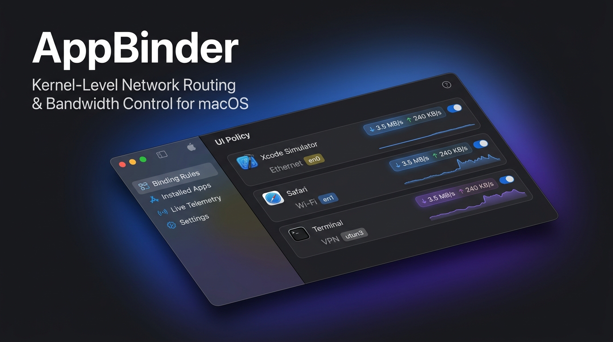
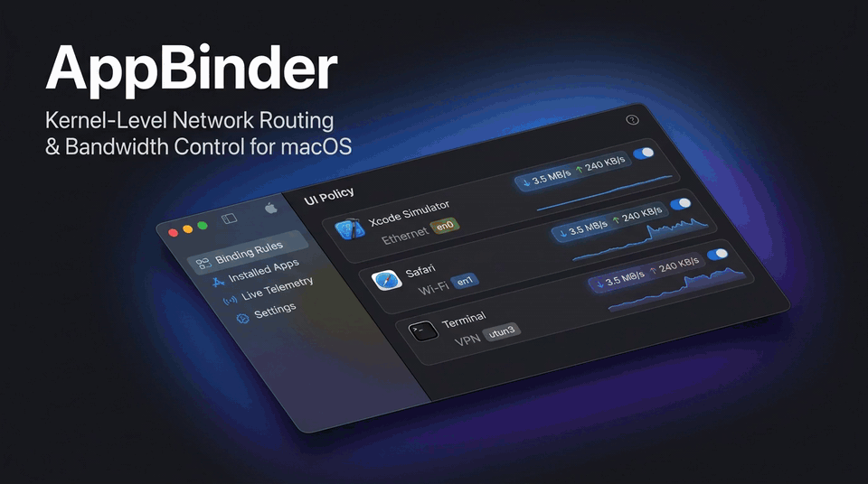
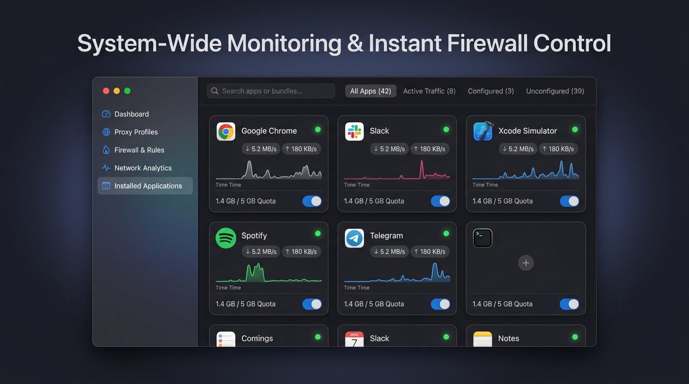
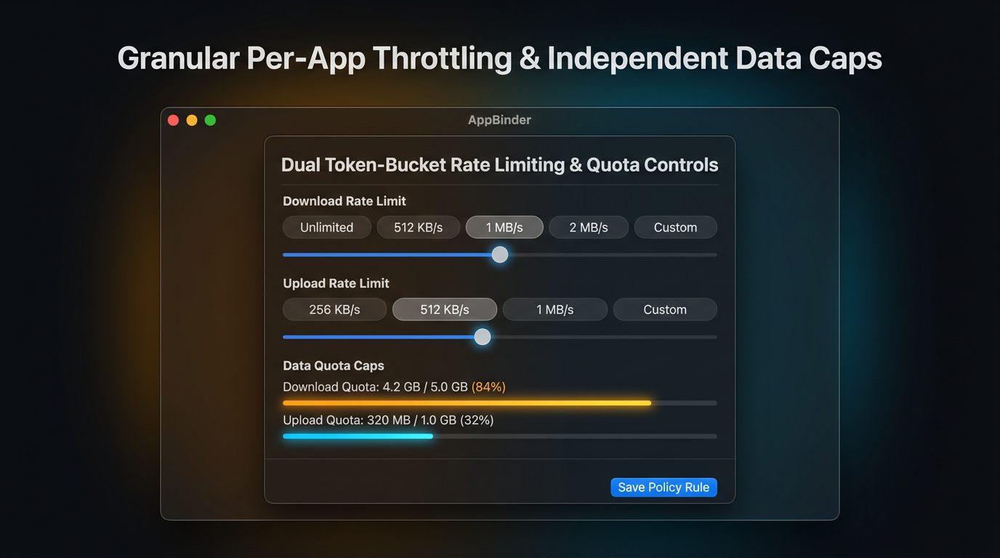
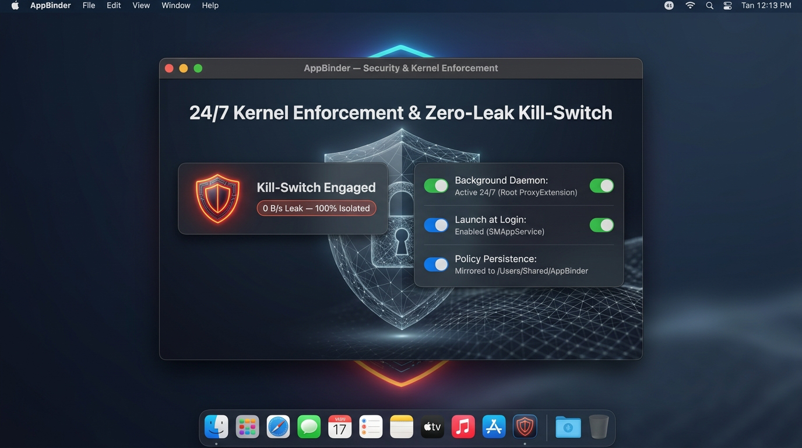

  

  
  <h1 align="center">AppBinder for macOS</h1>
  

    <strong>Kernel-Level Network Routing, Live Per-App Bandwidth Speeds, Dual Token-Bucket Throttling, Quotas, Zero-Leak Firewall Kill-Switch & 24/7 Autonomous Background Operation</strong>
  

  

    
    
    
    
  

---

## 🎬 Live Interactive Walkthrough

  

  <em>AppBinder in action: Real-time traffic monitoring, per-app network binding, rate throttling, and zero-leak firewall kill-switch.</em> 
  👉 <strong><a href="https://github.com/sohrabezzati/AppBinder/releases/download/v1.3.0/demo.mp4">Download or watch high-definition 60fps MP4 walkthrough video</a></strong>

---

## 🌟 Overview

**AppBinder** gives you uncompromising, kernel-level dominion over your Mac's network traffic. 

Route latency-sensitive applications (such as Xcode iOS Simulators, Google Chrome, Terminal, or Ghostty) directly through your physical **Gigabit Ethernet (`en0`)** to bypass VPN tunnels, completely isolate untrusted processes with a **Zero-Leak Firewall Kill-Switch**, set independent **Download and Upload Speed Caps**, monitor **Live Speeds (`⬇` / `⬆`)** across all applications, and enforce your policies **24/7 in the background** — powered directly by Apple's Network Extension kernel framework with zero overhead.

---

## ⚡ What's New in v1.3.0 (Build 11)

  

### 1. ⚡ Live Download & Upload Speeds & Per-App Data Usage
- **Real-Time Transfer Rates**: Instantaneous 1-second interval bandwidth meters display live speeds (e.g. `🟢 ⬇ 3.5 MB/s  ⬆ 240 KB/s`).
- **Cumulative Byte Meters**: Granular per-application accounting tracking total transferred data alongside dedicated Download and Upload breakdowns.
- **Active Traffic Indicators**: Real-time activity badges on every policy card in **Binding Rules** and in a live monitoring strip in **Live Telemetry**.

### 2. 🌐 System-Wide Telemetry for ALL Installed Apps (Even Unconfigured)
- **Continuous App Discovery**: The **Installed Applications** catalog continuously discovers and displays live transfer speeds and data consumption for **every installed application on macOS**, even before any rule is configured.
- **Active Quota Badges**: Instant visibility into active limits (`Cap: 500M Dl • 100M Ul`, `No Cap (Unlimited)`, or `Default Route`).
- **One-Click Firewall Toggle**: Instantly **Block / Unblock** network access with a single click directly from the application catalog.
- **Segmented Filter Controls**: Seamlessly toggle between **All Apps**, **Active Traffic** (apps actively streaming data), **Configured**, and **Unconfigured**.

  

### 3. 🎛️ Dual Token-Bucket Rate Limiting & Independent Data Caps
- **Independent Download & Upload Throttling**: Rate-limit downstream and upstream traffic separately (e.g., 2 MB/s download / 256 KB/s upload).
- **Smooth TCP Window Backpressure**: Limits speed smoothly without dropping packets or causing jitter.
- **Dual Live Progress Quotas**: Independent download and upload quotas with color-coded safety thresholds:
  - 🔵 **Normal** (<80% of limit)
  - 🟠 **Warning** (80%–99% of limit)
  - 🔴 **Quota Exceeded** (100% — traffic paused automatically at the kernel level)

  

### 4. 🌙 24/7 Autonomous Background Daemon (Works When App Is Closed)
- **Persistent Root System Extension**: Network interception, interface binding, rate throttling, and firewall kill-switches run continuously inside the privileged root System Extension (`com.sohrab.AppBinder.ProxyExtension`).
- **Managed by `sysextd` and `launchd`**: Runs 24/7 in the background without needing the `AppBinder.app` user interface to remain open.
- **Autonomous Disk Mirroring**: All active policies and byte counters are mirrored to `/Users/Shared/AppBinder/rules.json`, allowing the daemon to resume and enforce rules immediately upon system boot.

### 5. 🚀 Launch Automatically on macOS Login
- Native login item management powered by Apple’s modern `SMAppService.mainApp` API (macOS 14 Sonoma / 15 Sequoia).
- Toggleable directly from **Settings → Startup & Background Operation**.
- Guarantees silent background operation and instant rule enforcement upon system login.

### 6. 📱 Xcode iOS Simulator Network Binding & Live Speeds
- Full process attribution across CoreSimulator, `launchd_sim`, and helper runtimes (`configd_sim`, `simdeviceio`, `CoreSimulatorBridge`, `com.apple.WebKit.WebContent`).
- Bind iOS Simulators to physical Ethernet (`en0`) while your macOS host uses Wi-Fi or VPN, complete with live speed gauges and quota enforcement.

---

## 🛡️ Core Capabilities

| Feature | Description |
| :--- | :--- |
| **Interface Binding** | Force apps to bind strictly to physical interfaces (`en0`, `en1`, etc.) or VPN tunnels (`utun`). |
| **Firewall Kill-Switch** | 100% zero-leak kernel firewall immediately refusing unauthorized connections (`ECONNREFUSED`). |
| **Dual Rate Limiting** | Independent Download and Upload token-bucket limiters with smooth TCP window backpressure. |
| **Dual Data Caps** | Independent Download and Upload data consumption quotas with live warning meters. |
| **Process Tree Tracking** | CLI processes spawned in Terminal, iTerm2, or Ghostty automatically inherit their parent app's rule. |
| **Live Telemetry** | System-wide per-app live transfer rate tracking (`⬇` / `⬆`) and cumulative usage metrics. |
| **24/7 Root Daemon** | Privileged System Extension continues enforcing rules even when the GUI window is closed. |
| **Launch at Login** | Native macOS `SMAppService` startup integration with zero menu-bar clutter. |

---

## 🚀 Installation & Setup

### 1. Download
👉 **[Download AppBinder.dmg (v1.3.0 Build 11)](https://github.com/sohrabezzati/AppBinder/releases/latest/download/AppBinder.dmg)**

### 2. Move to `/Applications`
Open `AppBinder.dmg` and drag **AppBinder** into your **Applications** folder.

> [!IMPORTANT]
> macOS kernel security mandates that System Extensions reside within the root `/Applications` folder to be authorized by `sysextd`.

### 3. First Launch & Security Approval
Because AppBinder is distributed outside the Mac App Store:
1. **First Open**: Right-click (Control-click) `AppBinder.app` in `/Applications` and select **Open**, then confirm **Open**.
   *(Alternatively, run `xattr -cr /Applications/AppBinder.app` in Terminal).*
2. **Approve Extension**: When prompted by macOS, allow the Network Extension in:
   **System Settings → General → Login Items & Extensions → Network Extensions → Enable AppBinder**.

---

## 🛠 Quick Usage

1. **Launch AppBinder**: Verify the sidebar indicator shows `● Proxy Active`.
2. **Add a Policy Rule**:
   - Navigate to **Binding Rules** → click **Add Rule** (or browse **Installed Applications**).
   - Select your target application (e.g., Xcode Simulator, Chrome, or Terminal).
3. **Select Mode**:
   - **Route via Interface**: Select your network interface (e.g. Ethernet `en0`), and optionally configure Download/Upload speed limits and data quotas.
   - **Block Internet (Kill-Switch)**: Completely isolate the application with zero network leakage.
4. **Save Policy Rule**: Changes take effect immediately at the kernel level in real time!

---

## 🏗️ Architecture & Security

AppBinder is built on a modern, multi-tier privilege-separated architecture:

- **AppBinder.app (GUI)**: Sandboxed SwiftUI application providing real-time telemetry streaming, interactive configuration canvases, and login item management.
- **ProxyExtension (Root Daemon)**: Highly optimized Apple `NEAppProxyProvider` running as a root System Extension daemon managed by `sysextd`. Intercepts TCP and UDP network flows, enforces token-bucket rate limits, monitors bytes, and directs packets to bound interfaces.
- **UNIX Domain Socket IPC**: Low-latency bidirectional IPC over `/var/run/com.sohrab.AppBinder.sock` transmitting policy rules, live speed streams, and quota status with millisecond responsiveness.
- **Disk State Mirroring**: `/Users/Shared/AppBinder/rules.json` guarantees policy persistence across app relaunches, extension upgrades, and system reboots.

---

## 📄 Distribution

AppBinder is distributed as precompiled, signed binary releases for macOS. All rights reserved.
